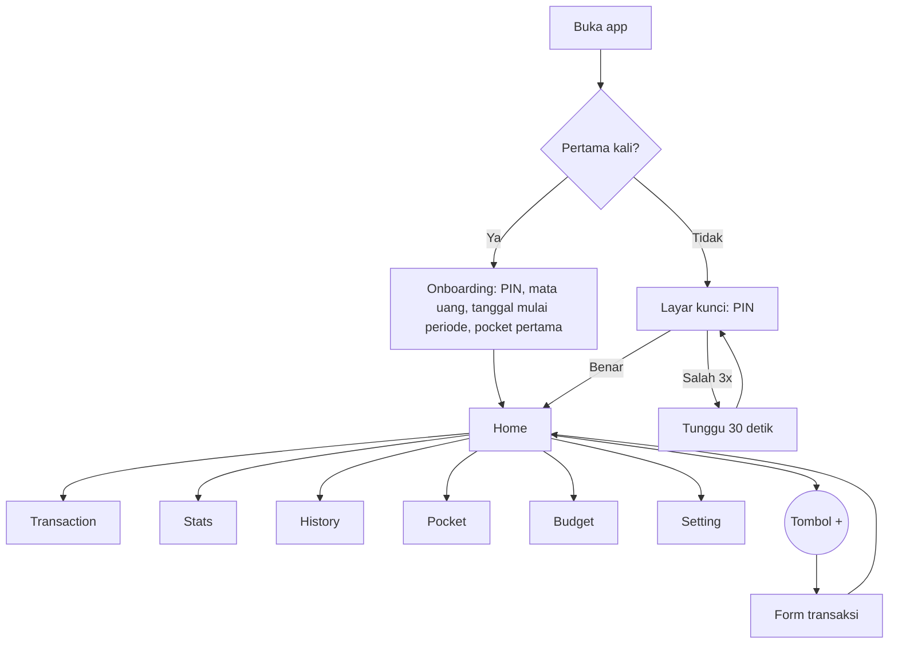
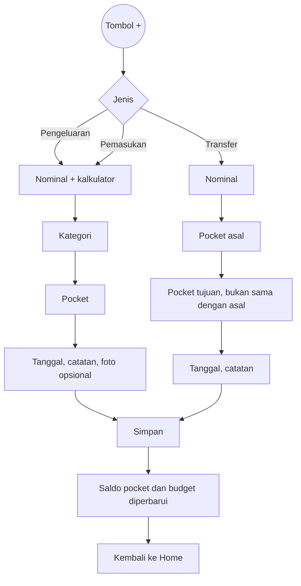
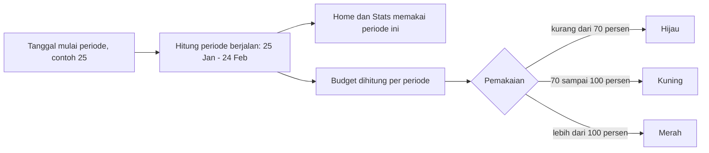
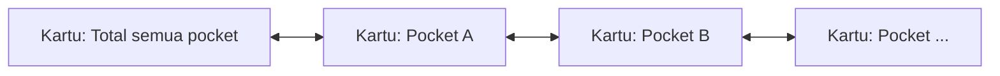
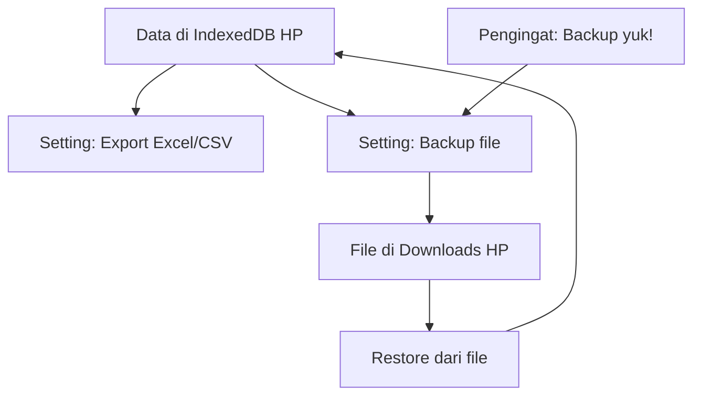
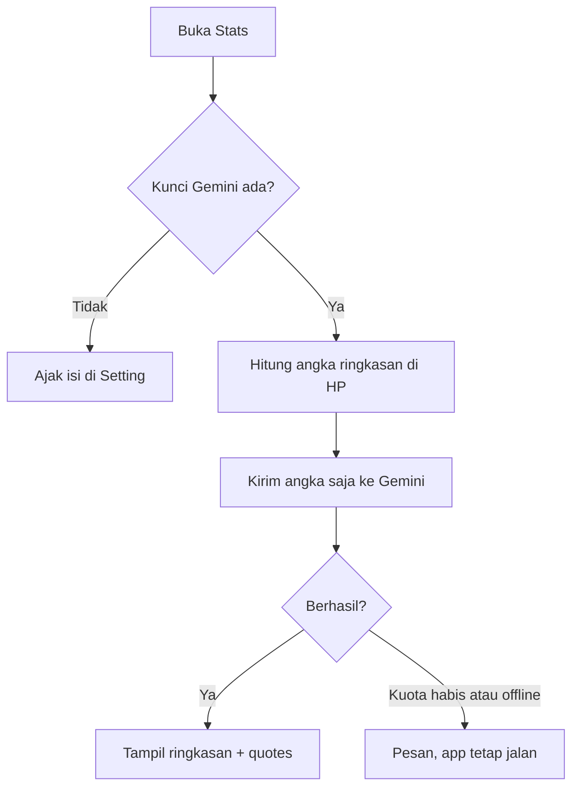
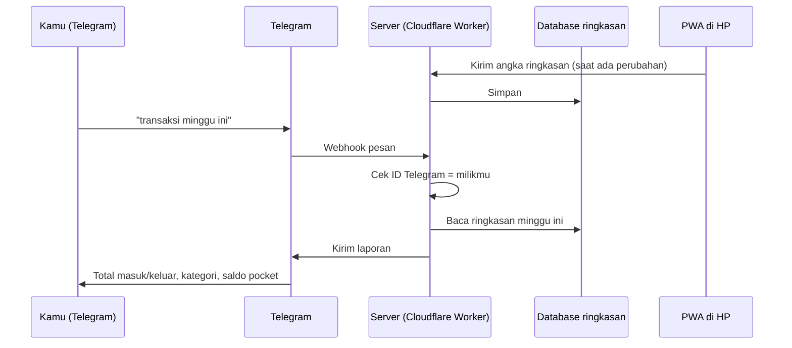

# MoniKu — Dokumen Desain Produk (PRD)

Status: Draft v3 (24 Nov 2026). Belum ada kode. Wireframe: `docs/wireframe/index.html`.
Repo: https://github.com/farrelale/MoneyTracker.git

## 1. Tujuan
Aplikasi pencatat uang pribadi untuk HP sendiri (tidak dijual, gratis). Mencatat pemasukan dan pengeluaran harian, rekap harian/mingguan/bulanan/tahunan, kategori, dan banyak pocket buatan sendiri.

## 2. Keputusan Teknis
| Hal | Keputusan |
|---|---|
| Bentuk | PWA (web app, Add to Home screen dari Chrome Android). APK nanti, bukan sekarang. |
| Hosting | GitHub Pages (gratis, HTTPS) |
| Data | Lokal di HP (IndexedDB). Tidak ada server di V1. |
| Nama app | MoniKu |
| Mata uang | Satu mata uang untuk seluruh app: IDR atau USD (pilih di Setting). Default IDR. |
| Font | Bisa dipilih di Setting: Inter (default), Plus Jakarta Sans, Assistant (font Kiro Crew). Semua gratis dari Google Fonts. |
| Tema awal | Ikut pengaturan HP (light/dark) |
| Bahasa app | Indonesia |
| Framework | Web biasa (bukan Flutter) |
| Chart | Chart.js (ringan) |
| Export | Excel (.xlsx) dan CSV |
| AI | Gemini Flash (gratis). Kunci API diisi user di Setting, disimpan di HP. Tidak ditaruh di kode. |

## 3. Aturan Bisnis (keputusan final)
1. **Saldo total** = jumlah semua pocket. Boleh negatif.
2. **Pocket boleh minus** (utang, kartu kredit).
3. **Kartu pocket di Home**: geser kiri/kanan untuk melihat saldo tiap pocket (Pocket A > Pocket B > ...). Kartu pertama = total semua.
4. **Kategori dihapus = soft-delete**: disembunyikan dari pilihan baru. Transaksi lama tetap memakai nama dan emoji lama.
5. **Kategori bawaan** tidak bisa dihapus permanen, hanya disembunyikan.
6. **Transfer**: pocket asal dan tujuan tidak bisa diedit. Hanya nominal, tanggal, catatan. Salah pocket = hapus lalu buat baru.
7. **Periode bulanan** mengikuti tanggal mulai (contoh tgl 25: 25 Jan s/d 24 Feb). Dipakai Home, Budget, Stats bulanan.
8. **Minggu** = Senin s/d Minggu (kalender biasa), tidak ikut periode custom.
9. **Transaksi tanggal masa depan**: boleh, tapi tidak masuk hitungan periode berjalan sampai tanggalnya tiba.
10. **Foto transaksi**: dikecilkan otomatis (maks ±200 KB). Peringatan jika penyimpanan >80%.
11. **Hapus pocket** yang punya transaksi: tidak boleh. Hanya diarsipkan.
12. **Budget** per kategori pengeluaran, per periode bulanan, diisi manual. Warna progres: hijau <70%, kuning 70–100%, merah >100%.
13. **PIN**: 6 digit, disimpan sebagai hash. Gagal 3x = tunggu 30 detik. Catatan: PIN hanya mengunci layar app, data di HP tidak terenkripsi.
14. **Backup**: pengingat manual "Backup yuk!" (berkala). Data hilang jika data browser dihapus, jadi backup/restore wajib ada.

## 4. Fitur

### 4.1 Transaksi
- Jenis: Pemasukan, Pengeluaran, Transfer antar pocket
- Isi: nominal (dengan mini kalkulator), tanggal, kategori, pocket, catatan singkat, foto (opsional)
- Edit dan hapus (aturan transfer lihat 3.6)

### 4.2 Kategori
- Pengeluaran bawaan: Makanan, Transportasi, Belanja, Tagihan, Kesehatan, Hiburan, Lainnya
- Pemasukan bawaan: Gaji, Lainnya
- Custom: nama + emoji

### 4.3 Pocket
- Nama custom (contoh: MBanking A, MBanking B, Cash)
- Tujuan (daily, investment, debt, dll, bisa custom) + deskripsi
- Saldo tiap pocket, boleh minus

### 4.4 Budget
- Per kategori pengeluaran, bulanan
- Tampil di Home sebagai perbandingan spending vs budget

### 4.5 Keamanan
- PIN (V1), sidik jari (V2, WebAuthn, perlu diuji di HP)
- Data lokal saja
- Tombol sembunyikan saldo (hide money)

### 4.6 AI (V1, opsional, butuh internet)
- Ringkasan pengeluaran periode ini
- Ask AI (contoh: "ringkasan 3 bulan terakhir")
- Quotes ramah (contoh: "Periode ini banyak spending di bucin, lagi seneng bahagiain pasangan ya!")
- Privasi: hanya kirim angka ringkasan (total per kategori, per periode). Jangan kirim catatan dan foto. Paket gratis Gemini boleh dipakai Google untuk melatih model.
- Jika kuota habis: tampil pesan, app tetap jalan.

### 4.7 Ditunda
- Suara (speech-to-text Indonesia+Inggris campur)
- Scan struk
- Multi mata uang per pocket

## 5. Menu
| Menu | Isi |
|---|---|
| Home | Kartu saldo (geser per pocket, tombol hide), grafik masuk vs keluar periode ini, spending vs budget, tombol + besar |
| Transaction | Daftar transaksi per hari |
| Stats | Filter daily/weekly/monthly/yearly, donat kategori, bar masuk-keluar, garis tren, ringkasan AI, Ask AI, quotes |
| History | Kalender; tap tanggal = daftar transaksi; tampilan minggu/bulan/tahun |
| Pocket | Daftar, buat/edit/arsip, saldo tiap pocket |
| Budget | Atur budget per kategori, progres, perbandingan dengan income |
| Setting | Tema, mata uang, kategori, tanggal mulai periode, export Excel/CSV, backup/restore, reminder, kunci Gemini |

## 6. Tampilan
- Bersih, minimalis, mudah untuk orang awam
- Navigasi di bawah, tombol tambah transaksi besar (jangkauan jempol)
- Format: Rp25.000 atau $4.00
- Tema: Light, Dark, Emerald, Rosé Pine, AMOLED (+ tema lain nanti). Memakai CSS variables.
- Font modern, jelas, mudah dibaca (usul: Inter atau Plus Jakarta Sans)

### Grafik per konteks
| Konteks | Jenis |
|---|---|
| Pengeluaran per kategori | Donat (maks 7 kategori + Lainnya) |
| Masuk vs keluar per hari | Batang |
| Tren beberapa bulan | Garis |
| Budget | Bar progres |
| Saldo antar pocket | Kartu geser |
| Ringkasan mingguan | Kolom 7 hari |

## 7. Rencana Rilis
| Versi | Isi |
|---|---|
| V1 | Transaksi (3 jenis), kategori, pocket, budget, Home (geser pocket), Transaction, Stats, History, tema, PIN, foto, export Excel/CSV, backup/restore, AI Gemini, offline |
| V2 | Sidik jari, notifikasi reminder, cari transaksi, template cepat, transaksi berulang, tombol bagikan ringkasan |
| V3 | Bot Telegram (lihat bagian 8), suara, scan struk |
| Nanti | Multi mata uang, target tabungan |

Catatan: jika V1 terasa terlalu besar, AI dipindah ke V1.5.

## 8. Rencana Integrasi Telegram (V3, belum dibuat)
Tujuan: ketik "transaksi minggu ini" di Telegram, bot membalas total masuk/keluar, per kategori, dan saldo tiap pocket.

Pilihan Telegram (bukan WhatsApp): daftar bot lewat @BotFather, gratis, tanpa nomor khusus, tanpa risiko blokir.

| Bagian | Tugas | Biaya |
|---|---|---|
| Bot Telegram | Terima dan balas pesan | Gratis |
| Server kecil (Cloudflare Workers) | Terima pesan, susun laporan, balas | Gratis (paket gratis) |
| Database server (Cloudflare D1/KV) | Simpan ringkasan angka | Gratis (paket gratis) |
| PWA | Kirim ringkasan ke server | Gratis |

Aturan:
- PWA hanya mengirim angka ringkasan (total per hari, per kategori, saldo per pocket). Catatan dan foto tidak dikirim.
- Bot hanya menjawab ID Telegram milik user. Selain itu diabaikan.
- Token bot dan rahasia server disimpan sebagai secret, bukan di kode.
- Tombol di bawah pesan: [Minggu ini] [Bulan ini] [Saldo pocket].
- Risiko: data ringkasan keluar dari HP ke server.

## 9. Diagram Alur

### 9.1 Alur utama aplikasi

### 9.2 Tambah transaksi

### 9.3 Periode bulanan dan budget

### 9.4 Home: geser pocket

### 9.5 Backup dan data

### 9.6 AI ringkasan (V1)

### 9.7 Bot Telegram (V3)

## 10. Risiko
| Risiko | Penanganan |
|---|---|
| Data hilang jika data browser dihapus | Backup/restore + pengingat |
| Penyimpanan penuh karena foto | Kompres foto, peringatan 80% |
| Data keuangan ke Gemini | Kirim angka ringkasan saja, kunci milik sendiri |
| Notifikasi tidak andal jika app tertutup | Jangan janjikan 100%, uji di HP |
| Data ke server (Telegram) | Ringkasan saja, bot hanya untuk ID sendiri |
| PIN tidak mengenkripsi data | Disadari. Enkripsi bisa dipertimbangkan nanti. |

## 11. Navigasi (disetujui, wireframe v2)
- Navigasi bawah 5 tab sama besar: Home · Transaksi · Stats · Pocket · Lainnya
- Tombol + (tambah transaksi) mengambang di kanan bawah, hanya di Home dan Transaksi
- Transaction + History digabung jadi tab "Transaksi" (Daftar / Kalender)
- Budget, Kategori, Export, Backup, Setting ada di "Lainnya"
- Pocket: ringkasan Aset · Utang · Total, lalu dikelompokkan per tujuan (Daily, Investment, Debt) dengan total per grup, diurutkan dari saldo terbesar
- Stats: Ringkasan AI di atas, setelah filter Hari/Minggu/Bulan/Tahun, sebelum grafik
- Backup & Restore: tombol info (ⓘ) yang menjelaskan alur backup dan restore
- Lupa PIN: tombol tetap tampil, fungsinya dibuat di V2
- Stats > Tren: ketuk titik data = tooltip berisi bulan, Masuk, Keluar, Selisih (target sentuh 48dp)
- Detail Pocket (ketuk pocket di tab Pocket): saldo + perubahan dari periode lalu, filter Minggu/Bulan/Tahun, grafik "Tren saldo" (saldo akhir tiap periode, ketuk titik = saldo), kartu Masuk/Keluar periode ini (termasuk transfer), daftar transaksi pocket itu saja dengan filter Semua/Masuk/Keluar/Transfer, tombol + yang otomatis memilih pocket ini

## 12. Pertanyaan Terbuka
1. Ikon aplikasi.
2. Warna tema final.
3. Persetujuan usulan navigasi di bagian 11.
